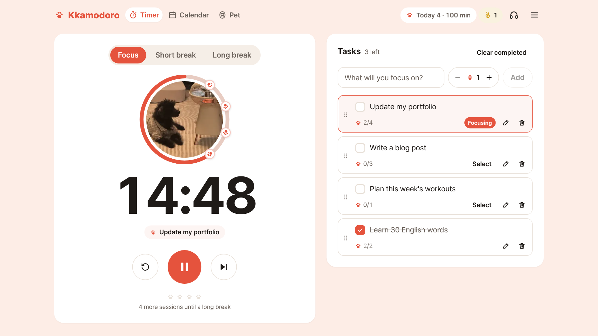
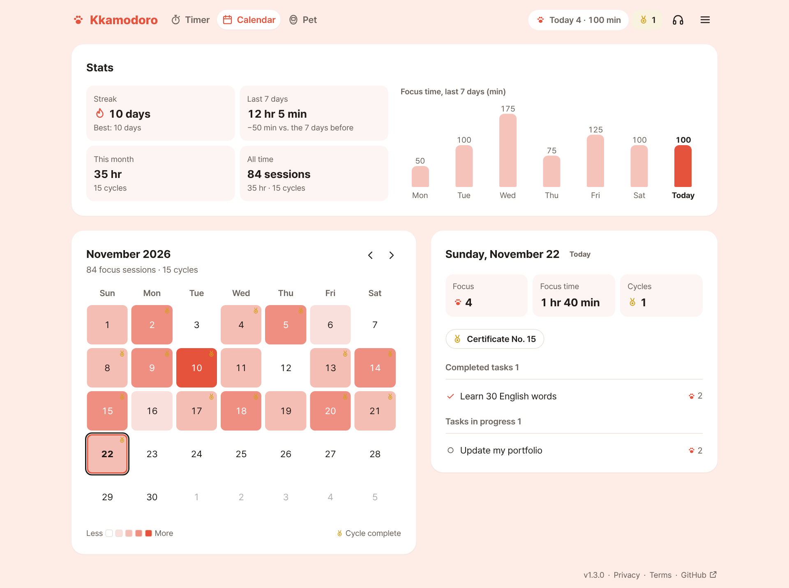
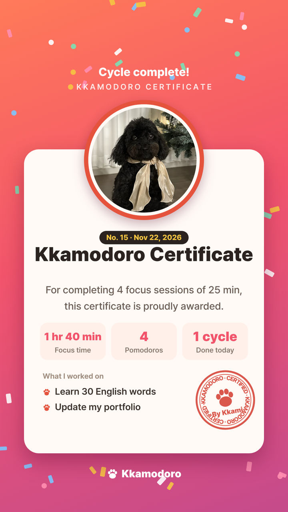

[한국어](./README.md) | **English**

# Kkamodoro

A pomodoro timer with **Kkami**, a black poodle.
Focus for 25 minutes, rest for 5, and repeat. After 4 focus sessions, you earn a Kkami certificate.
During breaks, look after a pixel Kkami like a Tamagotchi and take him for walks.

> Use it right away at **https://kkamodoro.vercel.app**. To run it on your computer, see [Getting started](#getting-started).

<!--
Screenshots: put the images in docs/images/ and uncomment the lines below.
<p>
  
  
  
</p>
-->

## Features

- **Timer**: focus, short break and long break. Change the durations and how often long breaks come in Settings. Auto-start (starts after 5 seconds, stops at the end of a cycle), a progress ring with paw stamps, and the time left in the browser tab title.
- **Tasks**: set how many focus sessions you expect a task to take with 🐾, and each finished session adds one. Reorder by dragging (mouse, touch or keyboard) and clear completed tasks.
- **Focus sounds**: 3 kinds of noise (white, pink, brown), 6 nature sounds (rain, rain on window, fireplace, forest, waves, stream) and 3 place sounds (airplane cabin, library, café). They play only while you focus, and "Random" picks a different one each session.
- **Calendar and stats**: daily focus count, time and finished tasks, plus your streak, the last 7 days, this month and all-time totals.
- **Kkami certificate**: finish a cycle and save or share that day's certificate as an image (1080×1920, Instagram story size).
- **Kkami care (Tamagotchi)**: on a handheld-console screen, pat Kkami, give treats (5 a day) and take walks (5 a day, each bringing home one item). As affinity grows he reaches new levels (5 in all) and gives hearts, and you craft windows, pots, wall-and-floor sets, rugs and outfits from your items and hearts to decorate his room. The view outside follows your device's time (dawn, day, dusk, night), and Kkami says more as you grow closer.
- **Meet Kkami on breaks**: when a break starts, a short "Play with Kkami?" note appears. During the break, the Tamagotchi page shows the time left and Kkami is awake to greet you. Nothing nudges you while you focus.
- **Alerts**: a chime when a session ends, and a browser notification if you're in another tab.
- **Sign-in (optional)**: sign in with Google or Kakao to save your tasks, history, settings and Kkami's care to your account and pick up on other devices. You can change your nickname or delete your account on your profile. Everything works without signing in.
- **Keyboard shortcuts**: `Space` start / pause, `R` reset, `N` next session, `S` settings.
- **Also**: dark mode, Korean / English, a first-visit intro and a guide page (`/guide`), keep screen on while the timer runs, and one shared timer across tabs.

### Where is my data saved?

- **Without signing in:** your tasks, history, settings and Kkami's care are saved **only in this browser (localStorage)**. Nothing is sent to a server, and clearing your browser data also deletes your history.
- **When you sign in:** your tasks, focus history and settings (durations, auto-start, focus sound, etc.) are also saved to your account (Supabase), so you can continue on other devices with the same account. Tasks and history saved in this browser before you sign in are merged into your account when you sign in. Sound volume, notifications, display settings, theme and language stay in this browser.
- **Kkami's care** is saved to your account too. If you look after him on two devices, pats, treats, walks and crafting all add up. On your first sign-in, this browser's Kkami goes up if your account has none yet; otherwise this browser switches to your account's Kkami.
- **Logging out** clears tasks, history, the timer and Kkami in this browser (they stay in your account). **Deleting your account** removes it and all data saved to it.

## Getting started

You need [Node.js](https://nodejs.org) **22.12 or later**.

```bash
git clone https://github.com/WonTaeJang/pomodoro-routine.git
cd pomodoro-routine
npm install
npm run dev
```

Then open http://localhost:3000 in your browser.

| Command                      | What it does             |
| ---------------------------- | ------------------------ |
| `npm run dev`                | Development server       |
| `npm run build`, `npm start` | Production build and run |
| `npm run test:run`           | Tests (Vitest)           |
| `npm run lint`               | Lint (ESLint)            |
| `npm run format:check`       | Format check (Prettier)  |

During development, add `?test=5` to the address to make every session 5 seconds long (`?test=off` turns it off). See the [setup guide](./docs/05-setup.md) (in Korean) for more.

To try sign-in, create a Supabase project and put its URL and publishable key in `.env.local`. Without them, only the sign-in menu is hidden and everything else works. To save to accounts, also run `sync-tables.sql`, `delete-account.sql` and `pet-game.sql` in `supabase/` (`admin.sql` for the admin page). ([Sign-in setup, in Korean](./docs/05-setup.md#로그인-supabase-설정))

## Tech stack

| Area       | What's used                                                                                 |
| ---------- | ------------------------------------------------------------------------------------------- |
| Framework  | Next.js 16 (App Router), React 19, TypeScript                                               |
| Styling    | SCSS Modules + design tokens, [Pretendard](https://github.com/orioncactus/pretendard) font  |
| State      | Zustand (saved to localStorage, synced across tabs)                                         |
| Sign-in    | Supabase Auth (Google, Kakao); account data in Supabase Postgres (row-level security)       |
| i18n       | use-intl (Korean, English)                                                                  |
| Other      | dnd-kit (drag to reorder), Web Audio API (alerts, focus sounds), Canvas (certificate image) |
| Kkami care | Rive (pixel Kkami animation), scripts that build the pixel art (`scripts/`)                 |
| Tests      | Vitest                                                                                      |

## Docs

The docs are written in Korean.

- [Doc index](./docs/README.md): planning, decision log, setup, design system
- [Changelog](./CHANGELOG.md)
- [Bug and improvement backlog](./docs/backlog.md)
- [Commit and versioning rules](./docs/commit.md)

## Credits

- Nature sound recordings: [Pixabay](https://pixabay.com) ([Pixabay Content License](https://pixabay.com/service/terms/)). The source of each sound is listed under "집중 소리" (focus sounds) in the [decision log](./docs/03-decisions.md#집중-소리-2026-11-08).

## License

The code is under the [MIT License](./LICENSE). The following are not covered by it:

- **Photos of Kkami** (`src/assets/kkami/`, and the link preview image `src/app/opengraph-image.png`), **mascot illustrations** (`src/assets/mascot/`), **pixel Kkami art** (`public/rive/*.riv`, `src/assets/kkami-pet/`, `src/assets/kkami-walk/`) and screenshots that include them (`docs/images/`): may not be used, modified or distributed without permission.
- **Focus sound recordings** (`public/sounds/`): edited from Pixabay recordings, so they stay under the [Pixabay Content License](https://pixabay.com/service/terms/) and may not be redistributed as standalone files.
